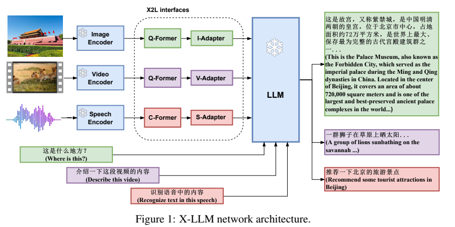
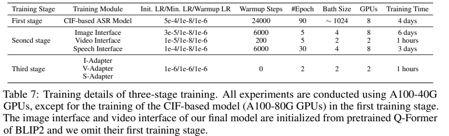
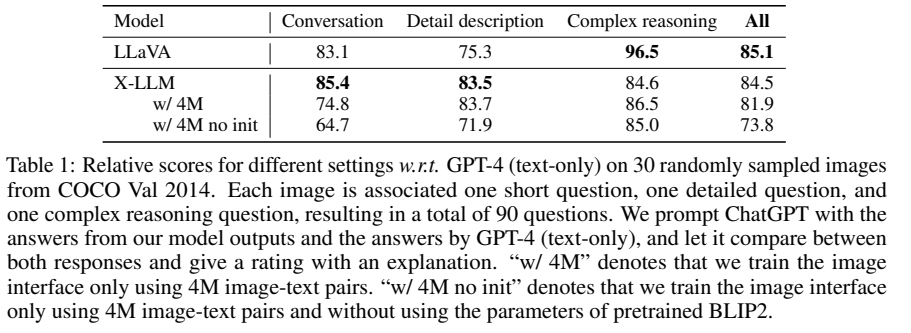
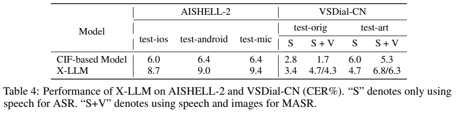

# X-LLM：把图像、视频和语音映射成语言模型可读的软表示

## 1. 论文信息与模型定位

| 项目 | 信息 |
|---|---|
| 论文 | *X-LLM: Bootstrapping Advanced Large Language Models by Treating Multi-Modalities as Foreign Languages* |
| 作者与机构 | Feilong Chen、Minglun Han、Haozhi Zhao、Qingyang Zhang、Jing Shi、Shuang Xu、Bo Xu；中科院自动化所、中国科学院大学 |
| 来源 | [arXiv:2305.04160v1](https://arxiv.org/pdf/2305.04160v1)，2023 年 5 月 |
| 官方资源 | [项目页](https://x-llm.github.io/)、[phellonchen/X-LLM](https://github.com/phellonchen/X-LLM) |
| 定位 | ChatGLM-6B 驱动的中文图像、视频、语音输入理解模型 |

“把模态当作外语”是接口设计类比：非文本信号转换为连续向量，再输入 LLM。它不要求先把图像翻译为离散汉字，也没有训练语音或图像生成器。总参数约 7.6B，包括编码器和 ChatGLM；6B 指语言骨干。（第 4、16 页）

## 2. 快速概览

| 输入 | 视觉/语音接口 | 输出及边界 |
|---|---|---|
| 图像 | ViT-g、Q-Former、I-Adapter | 中文回答；复用英文 BLIP-2 接口初始化 |
| 视频 | 共享 ViT-g、逐帧 Q-Former、V-Adapter | 拼接帧表示；不是独立的时空视频编码器 |
| 语音 | 卷积/Conformer、CIF、Transformer、S-Adapter | 转录或回答；覆盖语音，非一般环境音能力 |
| 图像 + 语音 | 两路软输入共同进入 ChatGLM | 展示视觉语音对话，识别精度并不保证提升 |

其主要贡献是冻结成熟骨干、训练独立模态接口，并以少量联合指令连接这些接口。论文声称的 84.5% 是特定参考评分比例，不能直接视为 GPT-4 的整体能力比例。

## 3. 整体架构

*Figure 1，PDF 第 3 页。各模态有自己的接口，语言输出由共享 ChatGLM 生成。*

图像接口用 BLIP-2 第二阶段预训练 Q-Former 初始化，生成 32 个查询表示，再经线性 I-Adapter 对齐 ChatGLM 嵌入维度。视频均匀采样 $T$ 帧，每帧使用相同机制，拼接后长 $32T$；帧数增加会线性增加输入表示数量，本文没有引入专门的跨帧压缩器。（第 4、16 页）

语音接口先由 CIF 将帧级特征压成 token 级表示，再经 12 层 Transformer 建模上下文，使用 bert-base-chinese 初始化，最后经线性 S-Adapter 映射语言空间。I/V/S 三种 Adapter 都是线性层。训练好 CIF-ASR 后，其编码器和 CIF 在后续语言对齐中冻结；ChatGLM 和视觉编码器也冻结。

## 4. 核心创新与数学原理

Q-Former 查询从视觉特征中提取语言相关表示，线性 Adapter 做维度对齐。视频只是对逐帧表示串联，因此视觉输入可以示意为 $Z_v=[Z_1;\ldots;Z_T]$。这些是对架构的数学表达，原文主文没有为它们提出新的独立优化公式。

CIF 的关键在可变长积分与触发：为语音帧分配权重，累计权重达到阈值时输出加权特征，并将边界帧权重分配到相邻输出。它使长帧序列与较短转录 token 序列对齐，避免把所有声学帧直接送入 LLM。论文此处沿用既有 CIF 方法，没有完整列出其所有训练损失系数，不能仅凭介绍推导出可复现的全部 ASR 配方。（第 4、16–17 页）

接口对齐及联合指令训练以目标文本预测为核心，一般可说明为：

$$
\mathcal L_{\mathrm{text}}=-\sum_t\log p(y_t\mid Z_i,Z_v,Z_s,q,y_{<t}).
$$

其中不存在的模态输入省略，$q$ 是指令；正文说明提示本身不单独计算预测损失。该公式是语言训练目标的解释性展开，而不是论文编号公式。英文 Q-Former 可以作为中文接口初始化，但最终使用约 14M 中文图文对继续训练，因而不能称为完全没有中文图文训练的跨语言零样本模型。

## 5. 数据构建与处理

图文训练集含 CC3M、COCO、VG captions、Flickr30k、SBU、AI Challenger、Wukong。英文数据翻译为中文；Wukong 用 CLIP 相似度大于 0.45 筛出约 10M 对，与其余约 4M 合成 14M。视频使用翻译的 MSRVTT 训练集，表 5 列约 7.7K 样本。（第 15–16 页）

语音使用 AISHELL-2 与自建 VSDial-CN。后者把 VisDial 文本翻译为中文，用在 AISHELL-3 上训练的 FastSpeech2 合成问题语音；约 1.2M 对话条目去重后约 370K 独立语音，二者不是同一计数。测试原始问题 2,000 条、人工另写 300 条，手机录音并统一为 16kHz，训练合成语音与测试真实录音有分布差异。

第三阶段表 5 报告约 10K 联合指令，正文分别描述翻译 MiniGPT-4 的 3.5K、选择 AISHELL-2 的 2K、ActivityNet 的 1K、VSDial-CN 的 1K，并使用不同指令模板。上述选择数与最终指令条目数不是逐项可直接相加的同一统计；文中没有给出完整展开去重规则。（第 6、15–16 页）

## 6. 训练流程与目标

*Table 7，PDF 第 16 页。CIF-ASR 使用 A100-80GB，其余主要为 A100-40GB。*

第一阶段训练 CIF-ASR，视觉侧直接继承 BLIP-2、跳过重新训练 Q-Former 的第一阶段。第二阶段分别对齐图像、视频、语音接口；第三阶段表 5/7 明确列出 I/V/S Adapter 三个线性层，不能概括成完整语言模型联合微调。（第 5、16 页）

| 模块 | 初始学习率 | epochs | GPU 数 / 报告时长 |
|---|---|---|---|
| CIF-ASR | $5\times10^{-4}$ | 90 | 8 / 4 天 |
| 图像接口 | $3\times10^{-5}$ | 5 | 8 / 6 天 |
| 视频接口 | $10^{-5}$ | 5 | 2 / 约 1 小时 |
| 语音接口 | $10^{-4}$ | 30 | 8 / 3 天 |
| 联合 Adapter | $10^{-6}$ | 2 | 2 / 约 1 小时 |

使用 AdamW，$\beta=(0.9,0.98)$、weight decay 0.05、余弦衰减；除 CIF-ASR 外梯度累积 16。图像为 $224^2$，使用随机裁剪与水平翻转。表中接口 batch 4/2 与累积设置并列给出，不应未经说明当成最终全局有效 batch。

## 7. 实验设置与主要结果

*Table 1，PDF 第 7 页。GPT-4 是读取描述和框的文本参考模型，不是同一输入下的视觉模型对照。*

视觉评测使用 COCO 验证集 30 图、90 问，将问题翻译为中文、模型回答再译成英文。GPT-4 依据人工描述和框生成参考答案，ChatGPT 评分。总体 84.5，低于所列 LLaVA 85.1；对话、细节为 85.4/83.5，复杂推理 84.6 低于 LLaVA 96.5。LLaVA 行采用另一裁判流程，所以只能粗略比较，不能视为统一评测的准确率。（第 6–7 页）

BLIP-2 初始化使 4M 配置相对分数从 73.8 到 81.9，支持接口复用；扩大为 14M 后总体到 84.5，但复杂推理 86.5→84.6，数据更多并非逐项改善。

*Table 4，PDF 第 9 页。指标为 CER%，越低越好；斜杠表示联合微调前后。*

AISHELL-2 三个设备测试 CER 为 8.7/9.0/9.4，弱于 CIF-ASR 的 6.0/6.4/6.4。VSDial-CN 的仅语音 CER 为 3.4/4.7，加入图像后升至 4.7/6.8；联合微调降为 4.3/6.3，仍未超过仅语音基线。论文展示联合输入能够回答问题，却没有证据支持“加入视觉一定改善 ASR”。视频、视觉语音对话及多模态翻译主要是定性案例，正文承认推理不可靠、事实编造与感知覆盖有限。（第 7、9–10、17 页）
