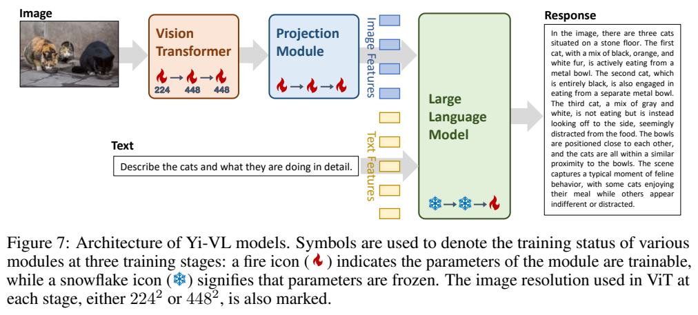
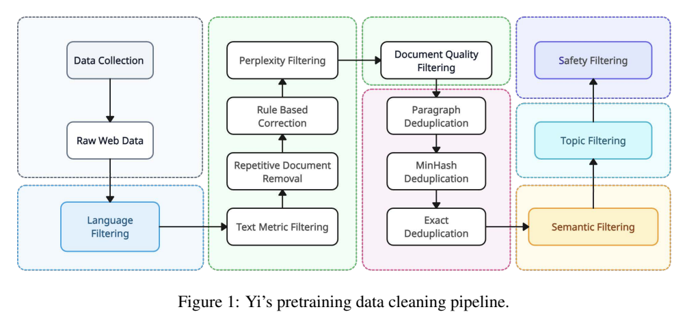
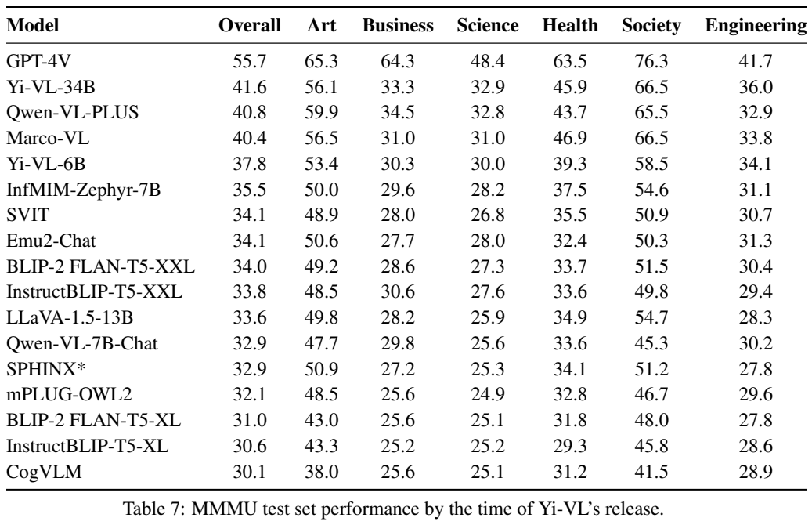
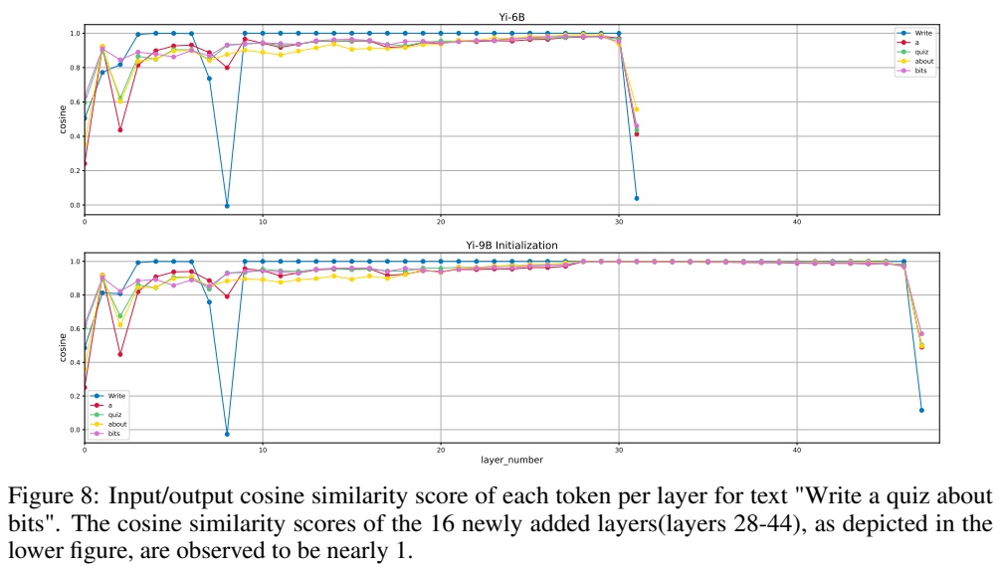

<!-- article-header:start -->
[项目首页](../../../README.md) › [模型系列](../../../reports/model-family-index.md) › [Yi-VL](../README.md)
<!-- article-header:end -->

# Yi-VL：以可训练视觉编码器和分辨率递进构建中英双语视觉助手

<!-- article-toc:start -->

**本篇目录** · [论文定位](#paper-info) · [快速概览](#overview) · [整体架构](#architecture) · [核心原理](#principles) · [数据构建](#data) · [训练流程](#training) · [实验结果](#experiments)
<!-- article-toc:end -->

## 1. 论文信息与模型定位

| 项目 | 信息 |
|---|---|
| 目录原条目 | Yi-VL，官方 Yi 仓库 VL 说明 |
| 主要解读来源 | Yi: Open Foundation Models by 01.AI，§7.2 Vision-Language |
| 版本与时间 | arXiv:2403.04652v1，2024-03-07；本篇锁定 v1 |
| 机构与家族 | 01.AI / 零一万物，Yi 家族 |
| 型号 | Yi-VL-6B、Yi-VL-34B，语言侧分别初始化自 Yi-6B-Chat、Yi-34B-Chat |
| 输入输出 | 图像和中英文本输入，文本回答输出 |
| 资源 | [技术报告](https://arxiv.org/abs/2403.04652v1)、[官方 VL 文档](https://github.com/01-ai/Yi/tree/main/VL)、[6B 权重](https://huggingface.co/01-ai/Yi-VL-6B)、[34B 权重](https://huggingface.co/01-ai/Yi-VL-34B) |

Yi-VL 是 Yi 语言模型的视觉扩展分支。技术报告还包含语言预训练、长上下文和深度扩展，但本篇的核心是 §7.2 的多模态模型。这样可以把 3.1T 语言 token、200K 语言模型上下文与视觉训练分开，避免将同一份家族报告里所有数字误当成 Yi-VL 配置。

模型沿用 LLaVA 式的视觉编码器、投影模块与语言模型组织方式，重点在于让视觉侧参与训练、提高输入分辨率，并在中英双语图文数据上递进训练。它的输出仍是文字，不包含原生图像生成或语音生成分支。

## 2. 快速概览

| 设计 | 具体选择 | 为什么有意义 |
|---|---|---|
| 视觉初始化 | CLIP ViT-H/14 | 使用已有视觉表示作为起点 |
| 投影 | 两层 MLP，加 LayerNorm | 将图像特征送到语言模型的表示空间 |
| 参数更新 | 前两阶段训练视觉与投影，最后全模型训练 | 先对齐再联合适应对话 |
| 分辨率 | 224×224 → 448×448 → 448×448 | 后期让模型处理更多局部细节 |
| 数据 | 大规模图文对逐步转向任务与对话数据 | 图像对齐、细节理解与助手行为有不同数据需求 |
| 主要视觉结果 | MMMU test：34B 41.6，6B 37.8 | 属于发布时比较表，不能与其他版本的 val 分数混用 |

理解本模型最有效的顺序是看 Figure 7 的三阶段火焰/雪花标记，再对照各阶段的数据、分辨率和学习率。参数更新范围与数据分布一起改变，所以最终提升不能仅归因于“图片变大”。[来源：PDF 第 15–17 页。](https://arxiv.org/pdf/2403.04652v1#page=15)

## 3. 整体架构

*原文 Figure 7，PDF 第 16 页原页。图中红色火焰表示更新，蓝色雪花表示冻结；视觉和投影模块三个阶段均训练，语言模型前两阶段冻结、第三阶段更新。*

输入图片先由 CLIP ViT-H/14 初始化的 Vision Transformer 编码，得到视觉特征；两层 MLP 加 LayerNorm 的投影模块把这些特征映射到语言模型可接收的空间。文本经语言侧嵌入得到文字特征，与视觉特征共同作为生成条件，最后由 Yi-Chat 主干产生中英回答。

语言侧采用稠密 decoder-only Transformer，6B 与 34B 主干分别为 32 层和 60 层，隐藏维度 4096 和 7168；报告 Table 1 的 Q/KV 头数分别为 32/4 和 56/8。它们描述语言基础模型，不能据此将整个视觉系统的总参数或显存直接等同于型号名中的 6B、34B。

官方 VL README 补充说明：图像占位符使用 `<image_placeholder>`，系统提示包含中英双语说明；相较 LLaVA，在两层 MLP 投影中加入 LayerNorm，并训练 ViT 参数。占位符和提示规定输入格式，真正传递视觉信息的是投影后的图像特征，不能将字符串占位符本身误当成图像内容。

## 4. 核心创新与数学原理

### 4.1 视觉对齐不只更新连接层

令图片为 $`I`$，视觉编码器为 $`E_\psi`$，投影模块为 $`P_\phi`$，语言模型为 $`F_\theta`$，可将数据流解释为

$$
V=E_\psi(I),\qquad Z=P_\phi(V),\qquad
p(y\mid I,x)=\prod_t p_{\theta,\phi,\psi}(y_t\mid Z,x,y_{<t}).
$$

这是对原图的数学重述，不是报告新增的编号公式。前两阶段固定 $`\theta`$，更新 $`\psi,\phi`$；最后阶段同时更新三组参数。这样，视觉侧能在保持语言基础能力作为参照的情况下学习对齐，而最终联合训练又让语言主干适应图像条件回答。

投影中的 LayerNorm 可以用标准解释式 $`\mathrm{LN}(h)=\gamma\odot(h-\mu)/\sqrt{\sigma^2+\epsilon}+\beta`$ 表示，其作用是控制表示的均值和尺度。原文没有展开两层 MLP 中每个归一化、激活的精确排列，本文不写一个未经配置验证的具体前向式；也不把 LayerNorm 的一般作用当成已经由消融证实的性能贡献。

### 4.2 提高分辨率对应更细的 patch 网格

ViT-H/14 的 patch 边长为 14。在只计 patch 网格、不计特殊 token 的解释下，224×224 对应 $`16^2=256`$ 个 patch，448×448 对应 $`32^2=1024`$ 个 patch，是四倍。这个计算说明为什么更大图片可能保留细文字和局部关系，也说明视觉处理成本会提高。

它不证明最终送入 LLM 的 token 数一定恰好为 256 或 1024：特殊 token 的保留、特征选择与序列模板仍需结合实现核查。训练分辨率提升也伴随数据变化，报告没有提供隔离变量的分辨率消融。

### 4.3 双语语言基础与视觉任务结合

Yi 主干使用 GQA，让多组 query head 共享较少的 key/value head，降低 KV 表示的成本；同时使用 SwiGLU 和 RoPE。它们来自语言基础模型，不是 Yi-VL 单独提出的视觉创新。视觉扩展的贡献是将双语 Chat 模型与可训练视觉模块、大规模图文训练以及最终多模态对话统一起来。[来源：PDF §2.3、§7.2。](https://arxiv.org/pdf/2403.04652v1#page=6)

## 5. 数据构建与处理

*原文 Figure 1，PDF 第 4 页原页。这是 Yi 语言主干的数据清洗流程，帮助理解 Yi-VL 的语言基础；不是视觉图文数据的完整处理流程。*

主干的中英预训练语料共约 3.1T tokens。报告介绍从 Common Crawl 经语言识别、困惑度、启发式规则、质量与连贯性评分、聚类、MinHash 和子文档精确去重构建语料。这里的 token 总量不能加到视觉阶段的图文对数量上，两者统计单位与用途不同。

Yi-VL 的数据按阶段组织：

| 阶段 | 数据与数量 | 数据作用 |
|---|---|---|
| 1 | LAION-400M 中约 100M 图文对 | 大规模视觉知识与语言空间对齐 |
| 2 | LAION-400M 中约 20M，加约 4.8M 多来源图文对 | 更高分辨率与任务覆盖；包括 CLLaVA、LLaVAR、Flickr、VQAv2、RefCOCO、Visual7w 等 |
| 3 | 约 1M 图文对 | 多模态对话；包括 GQA、VizWiz VQA、TextCaps、OCR-VQA、Visual Genome、ShareGPT4V 等 |

第三阶段每个来源最多贡献 50K 对，避免单一数据源支配对话训练。报告未给出每个来源过滤后的精确清单、中英占比、图像去重率和数据重叠情况，因此这些约数不应被解释成彼此完全互斥的独立图片量。

语言 Chat 模型使用少于 10K 的精修指令数据，是家族报告的另一部分；Yi-VL 第三阶段的约 1M 图文对是不同的统计范围，不能称整个 Yi-VL 只用“不到一万条指令”训练。[来源：PDF §2.1、§3.1、§7.2。](https://arxiv.org/pdf/2403.04652v1#page=16)

## 6. 训练流程与目标

| 阶段 | 分辨率 | 更新范围 | batch / learning rate / gradient clip / epochs |
|---|---|---|---|
| 1 | 224×224 | ViT + 投影；冻结 LLM | 4096 / 1e-4 / 0.5 / 1 |
| 2 | 448×448 | ViT + 投影；冻结 LLM | 4096 / 1e-4 / 0.5 / 1 |
| 3 | 448×448 | 整个模型 | 256 / 2e-5 / 1.0 / 2 |

第一阶段侧重广泛图文对齐，第二阶段扩大图像分辨率并增加视觉任务数据，第三阶段降低学习率、减少 batch 并联合训练全部参数，塑造多模态对话行为。原文报告使用 128 张 NVIDIA A100，6B 总训练时间约三天，34B 约十天；这是该训练方案的记录，不是任意复现环境下的固定时间保证。

从任务行为看，模型在图文条件下学习生成目标答案。可用条件负对数似然 $`-\sum_t\log p(y_t\mid I,x,y_{<t})`$ 解释生成监督，但 §7.2 未单独展开损失公式、具体 loss mask 或额外辅助项，本文不将概念重述当成完整训练代码。也没有证据表明这三个视觉阶段都采用 RL 或偏好优化。

分阶段的关键不是一个通用口号，而是明确的冻结状态与数据转换：语言模型先提供稳定的双语语义空间，视觉模块适应该空间，再共同优化对话任务。是否比始终冻结 ViT 或从第一步联合训练更优，报告没有给出专门控制实验。

## 7. 实验设置与主要结果

*原文 Table 7，PDF 第 17 页原页。表题明确为 Yi-VL 发布时的 MMMU test 结果；同页下方 Figure 8 属于 Yi 的深度扩展研究，不作为 Yi-VL 实验证据。*

| 模型 | Overall | Art | Business | Science | Health | Society | Engineering |
|---|---:|---:|---:|---:|---:|---:|---:|
| GPT-4V | 55.7 | 65.3 | 64.3 | 48.4 | 63.5 | 76.3 | 41.7 |
| Yi-VL-34B | 41.6 | 56.1 | 33.3 | 32.9 | 45.9 | 66.5 | 36.0 |
| Qwen-VL-PLUS | 40.8 | 59.9 | 34.5 | 32.8 | 43.7 | 65.5 | 32.9 |
| Yi-VL-6B | 37.8 | 53.4 | 30.3 | 30.0 | 39.3 | 58.5 | 34.1 |
| LLaVA-1.5-13B | 33.6 | 49.8 | 28.2 | 25.9 | 34.9 | 54.7 | 28.3 |

34B 相对 6B 总分高 3.8 个百分点；相对表中 Qwen-VL-PLUS 高 0.8，但艺术和商业类别并非更高。GPT-4V 总分高出 14.1 个百分点，说明当时仍存在明显差距。类别差异也提醒读者，不应只凭总体分数推断每个学科都领先。

表格是发布时榜单式比较，报告没有在该处提供所有模型统一重测的提示、随机种子或置信区间。它的 test 成绩也不能和别篇报告的 MMMU validation、不同 CoT 设置或更新版本直接拼接排名。Figure 7 的猫图详细描述是定性示例，说明模型能够生成细节丰富的描述，但不代替系统性幻觉或 OCR 测试。

公开证据支持双语视觉扩展与三阶段训练方案，并展示 MMMU 的竞争力。更细的结论，例如 LayerNorm 的单独增益、分辨率变化贡献、视觉微调是否影响纯文本能力，以及高分辨率 OCR 的上限，需要额外消融或评测；本篇不把家族语言模型的其他成绩自动转归 Yi-VL。

<!-- article-footer:start -->
---

[← 上一篇：SpatialVLM](../../spatialvlm/arxiv-2401.12168/README.md) · [按发表时间浏览](../../../reports/paper-reading-guide.md#year-2024) · [下一篇：InternLM-XComposer2 →](../../internlm-xcomposer/arxiv-2401.16420/README.md)

[返回本篇目录](#article-toc) · [返回模型系列](../README.md)
<!-- article-footer:end -->
